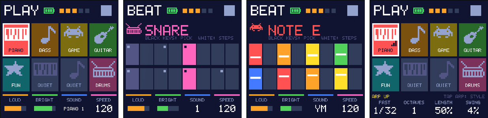

# FM1 Kids

A simple firmware for the [M-VAVE FM-1](https://www.m-vave.com/) pocket
synthesizer, made for young children. Big pictures instead of menus, keys that
always sound good, a drum machine on the white keys, and nothing a child can
break. It is built on M-VAVE's open-source
[FM1 Open](https://github.com/m-vave/fm1_open) firmware and keeps all of its
sound engines.

**[Install it from the browser](https://cds879.github.io/FM1-Kids-Firmware/)**
(Chrome or Edge, USB-C cable) · [Flashing guide](docs/FLASHING.md) ·
[Controls](app/kid/README.md)



> Unofficial and not affiliated with M-VAVE. Version 0.1 passes every test in
> an emulator of the FM-1 but has not yet been confirmed on a real FM-1. Back
> up your FM-1 first; see the [flashing guide](docs/FLASHING.md).

## What it does

- **Eight instruments as picture tiles:** piano, bass, game (chiptune), guitar,
  fun (samples) and drums. Turn SELECT to choose one and play the keys. On
  melodic instruments every key fits (a C major pentatonic scale), so nothing
  sounds wrong. Turn ALGORITHM to swap a tile's instrument.
- **BEAT mode (SEQ):** the 16 white keys are 16 steps and the black keys pick
  the drum or note. Key lights show the pattern and the playhead. Every drum
  appears on the grid, and melody steps show their note by color and height.
- **Arpeggiator (ARP):** tap for up, down, bounce or random; hold for "keep
  going"; hold and turn the knobs for speed, octaves, note length and swing.
- **Four knobs:** LOUD, BRIGHT, SOUND (with the sound's name) and SPEED.
- **Hard to lose work:** songs save themselves once left alone while stopped,
  EDIT is undo, and starting over asks first.
- **Kind to small ears and parents:** a volume cap, a battery gauge with a
  "charge me" warning, and a hidden parent panel (hold GLO) for Bluetooth MIDI
  keyboards. A keyboard on MIDI channel 1 plays the chosen instrument.
- **Never a dead end:** the firmware update path belongs to M-VAVE's SDK and
  can't be blocked by this interface. Stock firmware or any other FM-1
  firmware installs over it as usual.

## How it's made

M-VAVE's FM1 Open has two parts: an open-source app (GPL) and a closed binary
SDK with the sound engines. FM1 Kids replaces only the app's screen code. The
FM-1's flash is nearly full, so the kid interface replaces M-VAVE's menus
instead of sitting beside them. Set `FM1_KID_UI` to 0 in
[`app/kid/kid_config.h`](app/kid/kid_config.h) to build the original.

Every change is checked by GitHub Actions:

- the firmware is built with JieLi's Linux toolchain, and M-VAVE's own checks
  run on the finished image
- the firmware is tested in [fm1-emu](https://github.com/joakimeriksson/fm1-emu),
  an emulator of the FM-1, with scripted key presses that check the screen and
  sound: notes, patterns, undo, the arpeggiator, autosave across a power cycle,
  power cuts during saving, and more ([tests](tools/emu/README.md))
- the original interface is built from the same source and compared with
  M-VAVE's official release in the emulator, as a check on the toolchain
- after the tests pass on `main`, the browser installer is published to GitHub
  Pages

## Building

On a Mac or Linux, with [Docker](https://www.docker.com/products/docker-desktop/):

```sh
./build.sh preview            # browser preview: build/preview/index.html
./build.sh firmware           # firmware: build/dx7/generated/FM1_OFFICIAL_OPEN.fwsc
./build.sh preview --native   # preview without Docker (needs: brew install powershell)
```

The browser preview runs the whole interface without an FM-1 and builds in
seconds. Use it for most work. Details: [tools/unix/README.md](tools/unix/README.md).

On Windows, M-VAVE's original scripts still work (`build.bat`). They need
**JieLi Windows toolchain 2.5.3**
([installer](https://jl-update.oss-cn-shenzhen.aliyuncs.com/2.5.3.exe),
[installation guide](https://doc.zh-jieli.com/Tools/zh-cn/dev_tools/dev_env/jl_toolchain.html)),
with `FM1_PI32_TOOLCHAIN` set to its `pi32` folder (usually `C:\JL\pi32`). The
build checks the toolchain's files against `sdk/manifest.json`; for this SDK,
`pi32/bin/clang.exe` has SHA-256
`d4bc97cf421c1ccc373dd8924ce88720ff7457b3f1478d15df4aeda6ae923bce`. More in
M-VAVE's [FM1 Open README](docs/FM1-OPEN.md).

## Repository layout

| Path | What it is |
|---|---|
| `app/kid/` | The FM1 Kids interface, its settings and [controls](app/kid/README.md) |
| `app/`, `sdk/`, `web/`, `third_party/` | M-VAVE's FM1 Open app, SDK and browser preview (small, marked FM1 Kids hooks in `screen.c` and `midi_router.c`) |
| `tools/unix/`, `build.sh` | Builds on Mac, Linux and GitHub Actions |
| `tools/emu/` | Emulator tests |
| `tools/pages/` | The installer landing page |
| `docs/` | [Flashing guide](docs/FLASHING.md) and M-VAVE's [FM1 Open README](docs/FM1-OPEN.md) |

## Credits

- [M-VAVE](https://www.m-vave.com/): the FM-1 and FM1 Open (app source, SDK,
  sound engines and browser workbench)
- [Dexed / msfa](https://github.com/asb2m10/dexed): the FM engine inside FM1 Open
- [fm1-emu](https://github.com/joakimeriksson/fm1-emu) by Joakim Eriksson: the
  emulator used for testing
- [FM-1 Transporter](https://github.com/kurogedelic/FM-1-transporter) and
  [Felucca](https://github.com/hugelton/Felucca) by Leo Kuroshita: the recovery
  tool, and the reference for building on Linux and for the battery levels
- [FM-1-RE](https://github.com/AL-255/FM-1-RE) and the FM-1 community's
  reverse-engineering work

## License

The app is [GPLv3 with the FM1 SDK linking exception](LICENSE.md), as in FM1
Open. The sound engines come as M-VAVE's binary SDK under separate terms. Keep
[LICENSE.md](LICENSE.md) and the [SDK terms and third-party
notices](THIRD_PARTY.md) with any build you share.
